Execução: https://github.com/JhonatanTradeHunter/tvapp/actions/runs/42606387364

## Celular

**13 passaram, 0 falharam.**

| Resultado | Verificação | Detalhe | Print |
|---|---|---|---|
| ✅ | Versão antiga (banco v1): importar lista M3U |  | 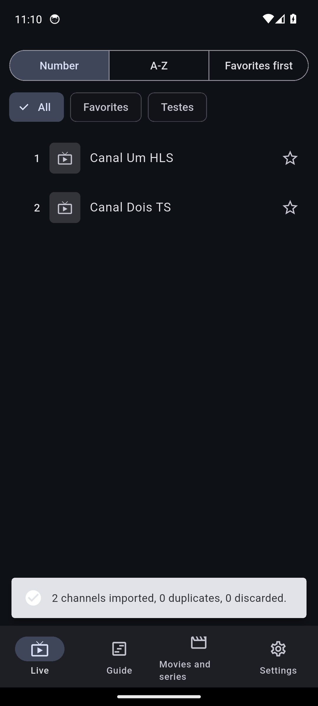 |
| ✅ | Migração v1 → atual: app abre e a lista continua lá |  | 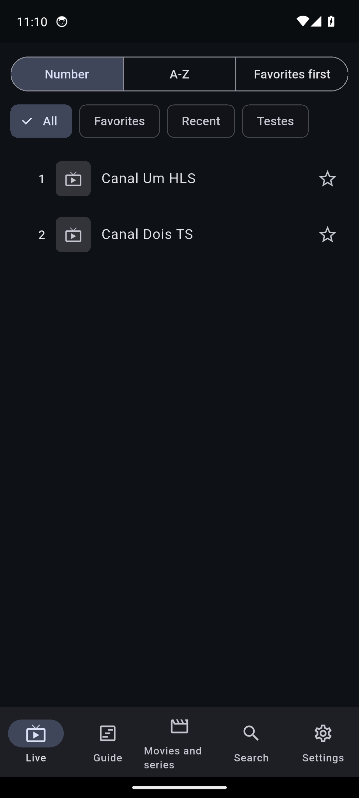 |
| ✅ | EPG disponível para a lista que veio da versão antiga | 1 pedido(s) de /epg.xml |  |
| ✅ | Tocar Canal Um HLS | 1 pedidos de mídia | 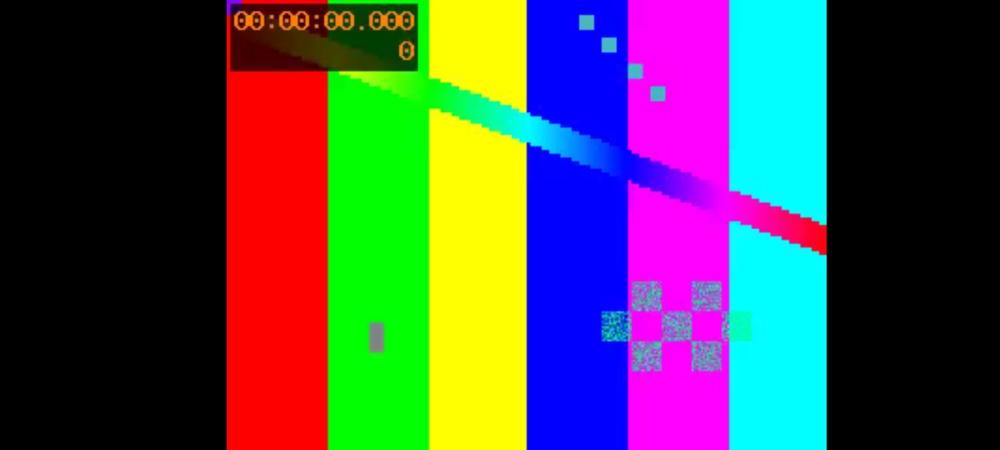 |
| ✅ | Tocar Canal Dois TS | 1 pedidos de mídia |  |
| ✅ | Depois de reimportar, o EPG é baixado | 1 pedido(s) de /epg.xml | 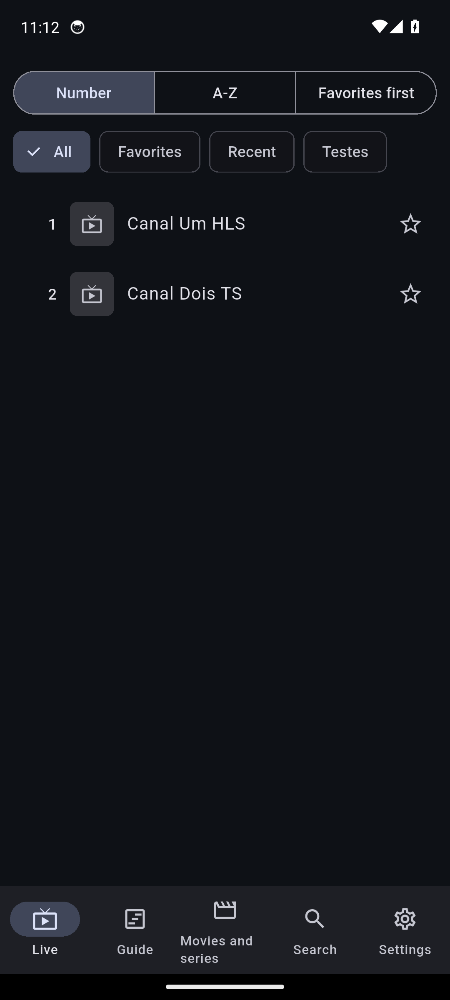 |
| ✅ | Catch-up M3U (catchup-source com {utc}) | pediu start=1794217200, esperado 1794217200 |  |
| ✅ | Importar fonte Xtream pela API | chamadas: auth, get_live_categories, get_live_streams, get_series, get_series_categories, get_vod_categories, get_vod_streams | 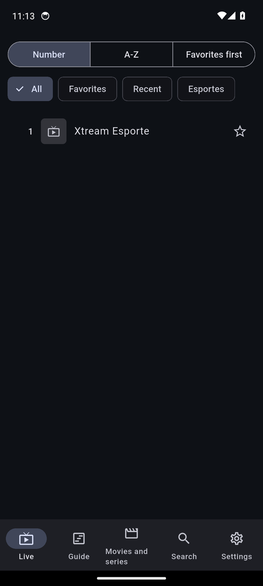 |
| ✅ | Tocar canal Xtream | 2 pedidos de mídia | 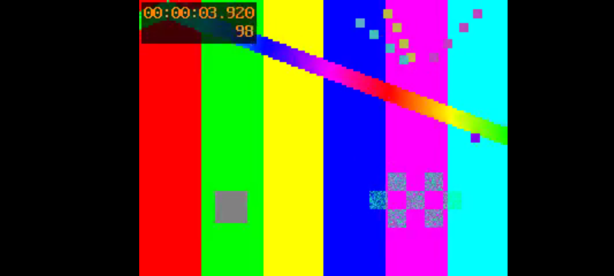 |
| ✅ | Catch-up Xtream (timeshift) | pediu 2026-11-09:06-40 = início no fuso do painel (-03:00). |  |
| ✅ | Reproduzir filme por 40s | 1 pedidos de mídia | 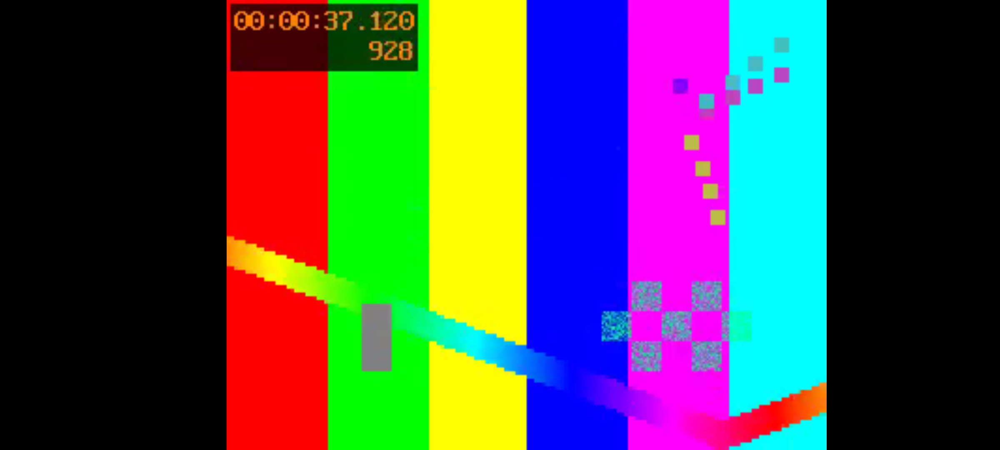 |
| ✅ | Retomar: filme oferece "Continuar de" | Resume from 00:39 | 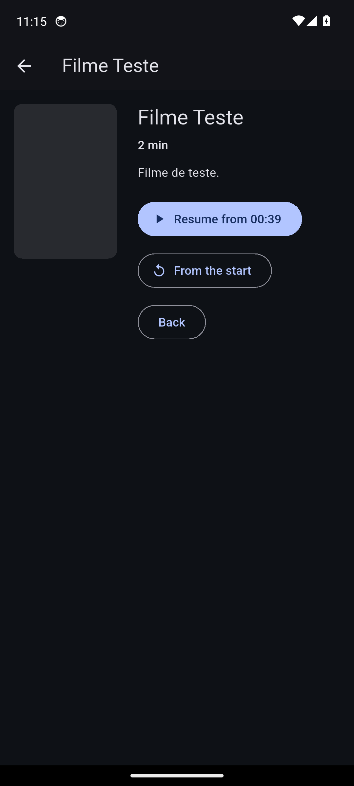 |
| ✅ | Abrir série e listar episódios | S1 E1, Episodio Um, 2 min | 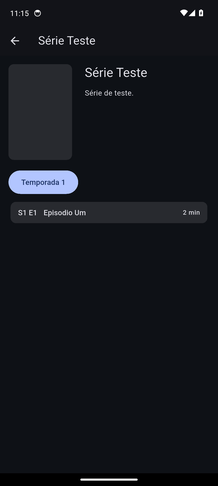 |

Diálogos do sistema fechados durante o teste: Pixel Launcher isn't responding

## TV (D-pad)

**7 passaram, 0 falharam.**

| Resultado | Verificação | Detalhe | Print |
|---|---|---|---|
| ✅ | TV: app abre na configuração | emulador com leanback | 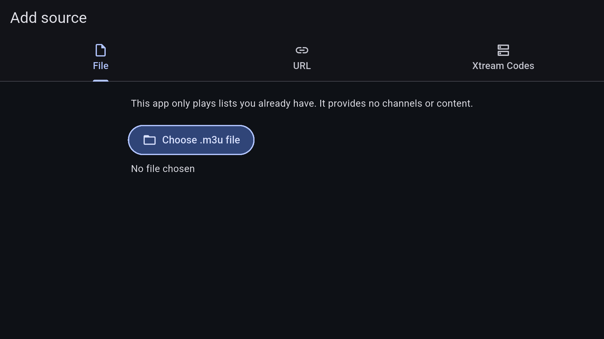 |
| ✅ | TV: importar M3U pelo D-pad |  | 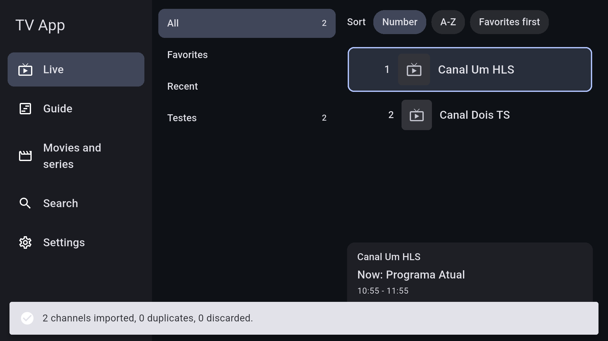 |
| ✅ | TV: navegar na lista pelo D-pad | 1, Canal Um HLS.  → 2, Canal Dois TS.  → 2, Canal Dois TS.  → 1, Canal Um HLS.  | 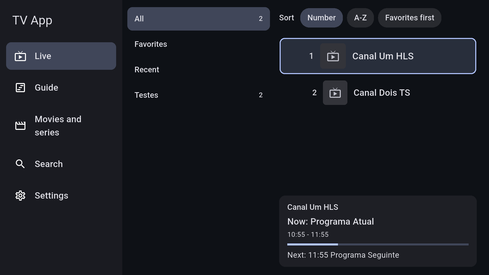 |
| ✅ | TV: tocar canal pelo D-pad | 1 pedidos de mídia |  |
| ✅ | TV: voltar do player com BACK |  | 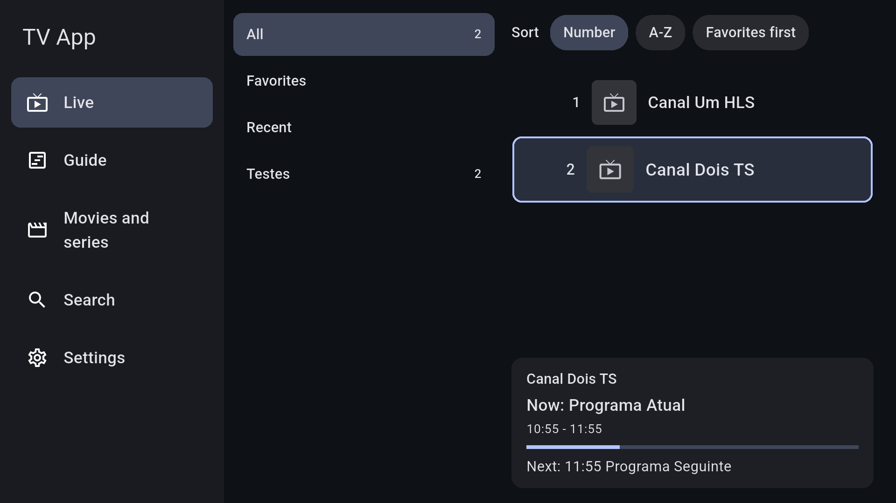 |
| ✅ | TV: abrir o Guia pelo D-pad |  | 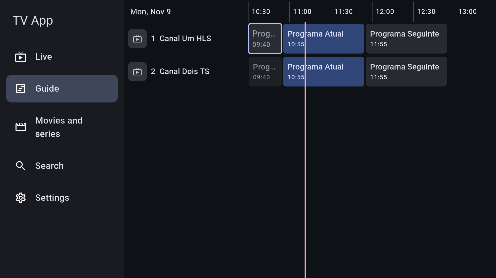 |
| ✅ | TV: voltar do Guia com BACK |  | 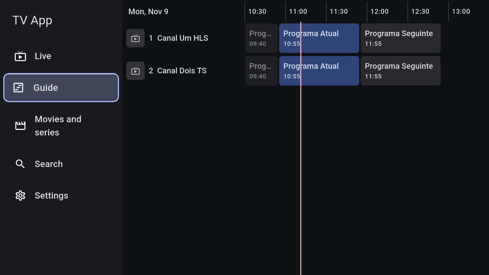 |
